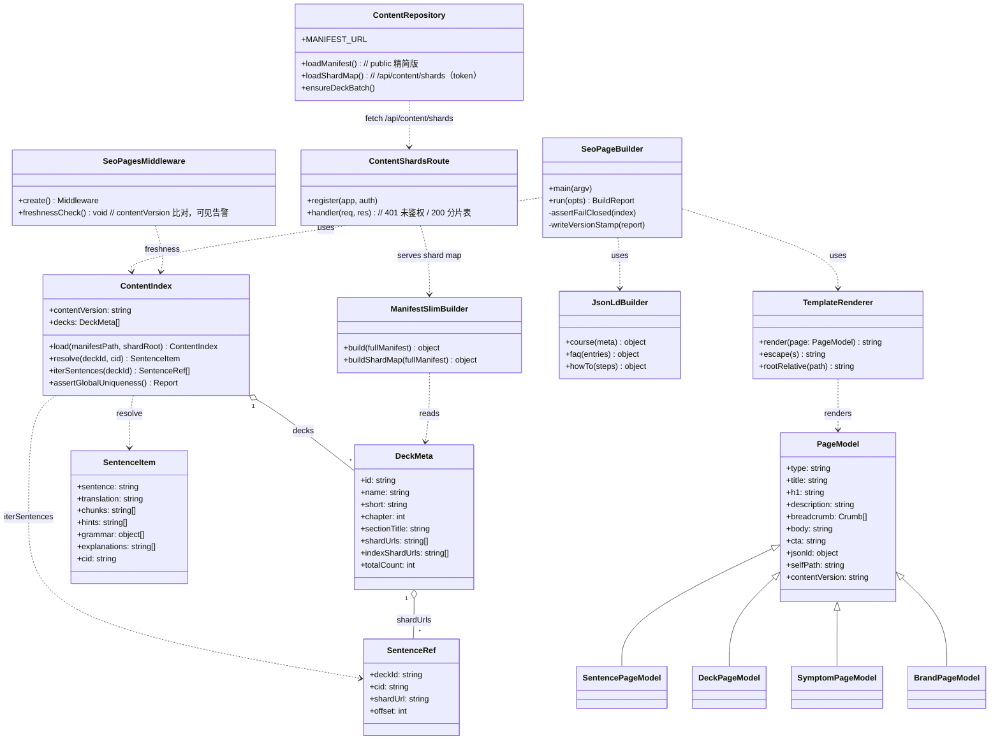
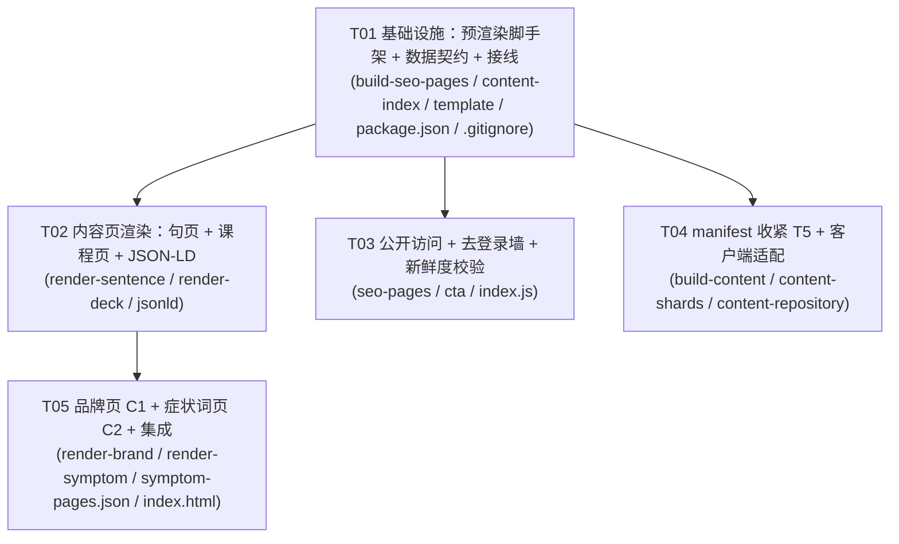

# Chunk Lab · SEO M1「内容对象化」架构设计 + 任务分解

**日期**：2026-10-07
**作者**：高见远（架构师）
**范围**：PRD `deliverables/product-strategy/seo-plan-chunklab-2026-10-07.md` §9.1 **M1** 的 **P0 X 类 8 条**：`T1 / T2 / T3 / T4 / T5 / C1 / C2 / C3`
**落地目录**：仓库根（服务端静态根 = 仓库根，`server/index.js:427` `express.static(path.join(__dirname,'..'))`）
**⛔ 本轮不做**：Y 类（robots / sitemap 扩量 / canonical / og:url / 站长平台 / 落地页占根 / 部署 / 301）。凡涉及域名一律**根相对**或占位，不落到线上。
**⛔ 本设计不含任何部署、push、commit 动作**；产出仅为本地文件。

> 证据口径：本文所有「已核实」判断均来自本轮**真实读码 / 本机实测**，逐条标注来源文件与行号。凡未读码验证的标注【推断·待确认】。

---

## 0. 一句话结论

> **采用「构建期预渲染」为唯一产出路径**：用零依赖 node 脚本遍历 `content/manifest.json` 指向的分片，产出**带完整正文的静态 HTML**（`/s/{deckId}/{cid}.html`、`/c/{deckId}.html`、`/g/{slug}.html`、`/about.html`），由现有 `express.static(仓库根)` 直接托管——**与「静态根=仓库根 + static-guard」零摩擦，且迁域不废**。`manifest.json` 改为**匿名可读的精简版**（只留元数据、不含分片内部路径）以过 T5；分片路径改由**鉴权接口 `/api/content/shards`** 提供，从而不打破现有「manifest + 分片」客户端加载链。登录墙（T3）由「内容页是纯静态公开文件」天然消除。

---

# Part A · 系统设计

## 1. 实现方案（选型与理由）

### 1.1 三个候选

| 方案 | 做法 | 与本仓库契合度 |
|---|---|---|
| **A 构建期预渲染**（推荐） | `node scripts/build-seo-pages.mjs` 读 `manifest.json` + 分片 → 写静态 HTML 到 `/s /c /g /about.html` | ✅ 最高 |
| B 请求时 SSR | Express 新增路由，按 URL 现渲染 | ⚠️ 中 |
| C 混合 | 预渲染为主 + SSR 兜底 | ⚠️ 中（复杂度↑） |

### 1.2 选型：**A 构建期预渲染**（B、C 落选，理由如下）

选 A 的**硬理由**（均来自本项目已核实的架构事实）：

1. **内容本来就是构建产物**：`scripts/build-content.mjs` 已把题库编译成「带内容 hash 的不可变分片 + manifest」，且 `manifest.contentVersion` 是一个内容哈希（实测 `content/manifest.json`：`"contentVersion":"v1-1aad…b04f1"`）。静态页天然可以挂在这个既有构建契约上——**产出时机与内容产物同源**。
2. **静态根=仓库根 + static-guard 早已就绪**：`server/index.js:417` `createStaticGuard()` → `425 staticCompress` → `427 express.static(仓库根)`。产出到根目录某个新文件夹即被自动托管 + 自动压缩（`server/compress.js` 已含 `.html` 类型）。SSR 反而要**插入一条动态路由**，改变「静态根」心智模型。
3. **static-guard 的规则决定「产出目录名」**（`server/middleware/static-guard.js:44`）：`SENSITIVE_PREFIX=/^\/(server|node_modules|output|scripts|extra|e2e|deliverables|deploy|ref)\b/i`。⇒ **静态页绝不能放进 `output/`、`scripts/` 等目录**（会被 403）。选 `/s /c /g` 等干净前缀（`/` 下、非敏感词、非 dotfile、扩展名 `.html` 不在 `SENSITIVE_EXT`）即可被正常托管。
4. **迁域不废**：静态 HTML 是纯文件，换个域名/nginx 原样可用；SSR 把渲染逻辑绑在 8787 进程上，迁域/换部署方式时是额外迁移面。
5. **爬虫语义**：爬虫不执行 JS，预渲染产出的一次性 HTML 与「请求时现渲染」对爬虫**等价**；但预渲染可被 `curl`/离线校验，验收成本最低（符合 PRD「`curl` 不执行 JS」验收口径）。
6. **项目铁律契合**：产出是**可复现**的（确定性、由 `contentVersion` 驱动），失败必须显式（见 §6.4 fail-closed）。

**B（SSR）落选理由**：需要把渲染模板同时搬进服务端进程；每条爬虫请求都要读盘/查内存；给「静态根」模型引入一条旁路；且 `T10 404 catch-all` 本轮不做 ⇒ 兜底语义不完整。**C（混合）落选理由**：M1 阶段收益（免重建即可刷新）低于其复杂度成本，且会与 T10 的边界纠缠；如需新鲜度，用 §3 的「构建触发 + 版本戳 + 启动期可见告警」即可覆盖。

> **决策留痕**：如后续（M2+）内容增速快到「构建即刷全量 3600+ 页」不可接受，再评估「预渲染首批子集 + SSR 兜底」的 C 方案。**M1 明确只做 A。**

### 1.3 关键前提（本轮**真读码**结论，必须遵守）

- **分片必须经 `manifest` 解析，禁止目录 glob**：实测 `content/oral-1-1-1/` 同时存在**两份**分片（`oral-001-3b2b8a9705f8.json` 与 `oral-001-7f7f3a88e1da.json`）——该 worktree 有并行会话/重建在写。⇒ 生成器**只能**信任 `manifest.json → decks[].shards[].url`，对目录做 glob 会把**孤儿/半成品分片**混进来。此点写进 §6.4 fail-closed 判据。
- **`cid` 不是全局唯一**：`cid = fnv8(sentence)`（`scripts/add-cids.js`）；构建期只断言**同一 deck 内** cid 唯一（`scripts/build-content.mjs:118-129`）。**本机实测**：66 deck / 3677 句，存在 **9 个 cid 跨 deck 重复**（例：`26811d24 → [oral-1-4-1, builtin-freq-idioms]`，均为「同一句文字出现在两个 deck」）。⇒ **URL 必须 deck 限定**（见 §2），否则会覆盖/串页。
- **句数口径**：`sum(totalCount) = sum(shards[].count) = sum(indexShards[].count) = 3677`（本机实测）；PRD 的「7354 条」= 3677×2，系**详情分片 + 索引分片各计一次**的重复口径，**真实句子 = 3677**（去重 cid = 3668）。见 §11 待明确#2。
- **`core.js:2461`「不可被改写」边界**：指「页面不直接加载大文件、必须走 manifest + 分片」。**本设计完整保留这条链**（§6.3），T5 仅把「分片路径」从匿名 manifest 移到鉴权接口，未改变「manifest + 分片按需加载」范式。

---

## 2. URL 方案（根相对，迁域不废）

| 页面类型 | URL（根相对） | 对应需求 | 说明 |
|---|---|---|---|
| 意群句页 | `/s/{deckId}/{cid}.html` | C3 / T1 | **deck 限定**，规避 9 处跨 deck cid 重复；`(deckId,cid)` 与「分片文件 + offset」一一对应 |
| 课程页 | `/c/{deckId}.html` | T1 | 每 deck 一页，列出该 deck 全部句子内链（可索引聚合点） |
| 症状词方法论页 | `/g/{slug}.html` | C2 | `slug` 来自内容运营数据文件（如 `sentences-too-long.html`） |
| 品牌说明书页 | `/about.html` | C1 | 独立稳定 URL，避免占用根（根 = 现有落地页 `index.html`，属共享文件） |
| 练习入口 CTA 目标 | `/main.html?deck={deckId}` | T3 | **不遮挡正文**；在 prod 可能要求登录，但**不影响正文可读** |

**纪律**：所有内链/JSON-LD 一律以 `/` 开头的**根相对**路径书写；**禁止**出现任何 `https://<域名>` 绝对地址（T2 验收项；也是迁域不废的前提）。Y 类的绝对域名仅允许出现在 `robots.txt` / `sitemap.xml`（本轮不改）。

**为何不采 PRD §7.2 的字面 `/s/{句子ID}.html`**：实测 9 处 cid 跨 deck 重复 ⇒ 扁平 URL 会**串页/覆盖**。deck 限定仍满足「每句一独立 URL、标题模板可复现」。若团队坚持扁平 URL，必须先解决 cid 跨 deck 冲突（去重 + 显式报告），见 §11 待明确#3。

---

## 3. 内容新鲜度策略

**单一事实来源 = `manifest.contentVersion`（内容哈希）。** 三期联动：

1. **构建期（产出）**：`build-seo-pages.mjs` 在每次内容重建后重跑；产出目录写一份 `/{pagesRoot}/version.json`：`{ contentVersion, generatedAt, pageCount, generatorVersion }`。页面 `<head>` 内嵌 `<meta name="clb:content-version" content="{contentVersion}">`。
2. **接线（触发）**：把 `node scripts/build-seo-pages.mjs` 追加进 `package.json` 的 `content:assemble`（以及 `pretest` 的 `prepare:test` 之后一步），使「内容重建」必然带动「静态页重建」；并提供独立 `npm run seo:build`。支持环境变量 `SEO_LIMIT`（首批 N 页）与 `SEO_ONLY`（限定类型），便于首批灰度。
3. **运行期（可见校验，fail-closed 而非静默）**：服务启动时（`server/index.js` `app.listen` 前后）比对 `version.json.contentVersion` 与 `content/manifest.json.contentVersion`：
   - **一致** → 静默通过；
   - **不一致或 `version.json` 缺失** → 打**显式 `console.warn`**（含两者 contentVersion），**不静默**。按项目铁律「找不到就静默跳过」明令禁止 ⇒ 新鲜度落后必须**可见**。是否升级为 fail-fast（拒绝启动）见 §11 待明确#6，M1 采用「可见告警」而非「拒绝启动」（避免阻塞无关开发）。

---

## 4. 生成产物去向（入库 vs 运行期生成）

**决策：产出目录 `gitignore`，不入库，构建期生成。**

理由：
- **体量**：全量 ≈ 3677 句页 + 66 课程页，单页 4–6 KB ⇒ **约 20–30 MB**，且几乎全是内容哈希驱动的可再生品——入库会让「内容一变就产生海量 diff」，污染 `git status`（本 worktree 已有并行写入，尤需克制）。
- **单一事实来源**：页 = `f(manifest, 分片)`，与分片同源、可确定性重建；入库会引入「手改了某页」的漂移风险。
- **与部署白名单 `FILES`（`scripts/deploy-prod.sh:42`）的关系**：
  - `FILES` 是**白名单**，且 `scripts/check-deploy-files.js` 会按「HTML 引用 + ESM import 闭包 + manifest 图标 + server require 闭包 + SW 两类缓存资源」**自动算出必需项**并与 `FILES` 比对，缺一即中止部署（`check-deploy-files.js:240-254`）。
  - 因此生成页若要上线，必须：① 在 `deploy-prod.sh` 的 **tar 之前**跑一次 `node scripts/build-seo-pages.mjs`（保证产物存在且最新）；② 把产出**目录项**加入 `FILES`（目录项可覆盖其下全部必需文件，见 `check-deploy-files.js:203-227` 的目录覆盖逻辑）。
  - ⚠️ **`check-deploy-files.js` 目前不认识新目录**：目录项若「覆盖 0 个必需路径」会被标为「非必需」仅提示（不致命）；若生成页由 manifest/SW 闭包引用则会被要求。**本轮（M1）不部署**，故**只落本地 + 生成器脚本**；部署脚本的上述两处改动**写成待执行清单**（Y 类授权后再动），见 §8 共享知识与 §11。
- **产出目录命名**（避开 static-guard 敏感前缀）：根目录 `/s`、`/c`、`/g`，以及 `/about.html`。`.gitignore` 追加：`/s/`、`/c/`、`/g/`、`/about.html`（`/about.html` 是否忽略见 §11 待明确#4，建议忽略，与内容同源再生）。

---

## 5. 文件列表（新增 / 修改，相对路径）

**新增（本轮 M1）**

```
scripts/build-seo-pages.mjs          # 产出管道 CLI 入口：编排、确定性、version.json、fail-closed
scripts/seo/content-index.mjs        # 读 manifest→分片→构建 (deckId,cid)→item 解析器；全局唯一性/缺失断言
scripts/seo/template.mjs             # HTML 外壳 + 渲染契约（唯一 H1 / description / 面包屑 / 根相对 / 版本戳）
scripts/seo/render-sentence.mjs      # 意群句页渲染器（原句/意群/AI 详解/词卡 四要素）
scripts/seo/render-deck.mjs          # 课程页渲染器（句子内链聚合）
scripts/seo/render-brand.mjs         # C1 品牌说明书页（/about.html）
scripts/seo/render-symptom.mjs       # C2 症状词方法论页模板
scripts/seo/jsonld.mjs               # JSON-LD 生成器（Course / FAQPage / HowTo，根相对）
scripts/seo/cta.mjs                  # 共享 CTA + 内链 partial（练习入口，不遮挡正文）
content/seo/symptom-pages.json       # C2 内容运营数据（≥10 条症状词页条目；模板的输入）
server/middleware/seo-pages.js       # 服务端：/s /c /g 公开托管策略 + 缓存头 + 新鲜度可见校验
server/routes/content-shards.js      # T5：GET /api/content/shards（鉴权）返回完整分片路径表
server/content/shards.json           # T5：完整分片路径表（生成物；位于 server/ ⇒ 被 static-guard 401/403 保护，不可匿名直取）
docs/architecture/seo-m1-content-objectification.md   # 本文档
docs/architecture/seo-m1-class-diagram.mermaid        # 类图
docs/architecture/seo-m1-sequence-diagram.mermaid     # 时序图
```

**修改（本轮 M1）**

```
package.json                  # +scripts.seo:build；把生成器接入 content:assemble / prepare:test
.gitignore                    # 忽略 /s/ /c/ /g/ /about.html（生成物）
server/index.js               # 挂载 seo-pages 中间件（static-guard 之前）+ 注册 /api/content/shards
scripts/build-content.mjs     # T5：产出「精简 public manifest」+「完整 server/content/shards.json」
js/content-repository.js      # T5：分片路径改由 /api/content/shards（带 token）获取；保留 manifest+分片范式
index.html                    # C1：加入 1 行指向 /about.html 的内链（⚠️ 共享文件，需与并行会话协调，见 §11#5）
```

> ⚠️ **并行写作者警告**：`main.html` 正被另一会话修改，**本设计不触碰 main.html**。`index.html` 的 C1 内链改动很小，但仍属共享文件，实施时先与团队确认无冲突。

---

## 6. 数据结构与接口

### 6.1 句页数据契约（`SentencePageModel`）

由 `content-index.mjs` 从分片 item 派生（分片 item 实测字段：`sentence / translation / chunks / hints / cid`，可选 `grammar / explanations / distractors`）：

| 页面要素 | 来源字段 | 备注 |
|---|---|---|
| ① 原句 | `item.sentence` | 必填；缺失即 fail-closed |
| ② 意群切分 | `item.chunks[]` | 分段展示；缺失即 fail-closed |
| ③ AI 详解 | `item.explanations[]` | 容许为空数组（可见「暂无详解」而非静默空页）|
| ④ 词卡 | `item.translation` + `item.hints[]` + `item.grammar[]` | 词卡 = 目标词/释义/音标(pos/phonetic/meaning) |
| 面包屑上下文 | `deck.name / deck.short / deck.chapter / deck.sectionTitle` | 来自 manifest 元数据 |

`meta description` 模板（≤160 字符）：
`{原句} —— 按意群切分为 {N} 段，附逐段 AI 详解与跟读练习，未登录可直接体验。`
标题模板（症状/长尾优先，术语作锚点）：
`{关键短语/句式} 意群怎么断｜{课程名} · Chunk Lab`

### 6.2 manifest 精简版 schema（T5）

**public**（`content/manifest.json`，**匿名可读、静态文件**——必须保持静态文件，因 SW `PRECACHE` 含 `/content/manifest.json` 且用原子 `addAll`，非 200 会让 SW 安装失败，见 `sw.js:60-63,264-268`）：

```jsonc
{
  "schemaVersion": 1,
  "contentVersion": "v1-…",          // 内容哈希，保留
  "series": "口语3000句",
  "chapters": [ { "no": 0, "title": "…" } ],
  "decks": [                          // 仅元数据；★ 移除 shards / indexShards
    { "id": "oral-1-1-1", "name": "…", "short": "…", "desc": "…",
      "chapter": 1, "section": "1.1", "sectionTitle": "在家中", "topic": "…",
      "baseCount": 0, "totalCount": 94 }
  ]
}
```
> 兼容性：客户端 `loadManifest` 校验仅要求 `schemaVersion===1 && Array.isArray(decks)`（`content-repository.js:255`），元数据缺 `shards` 不影响目录渲染（`installSummaries` 只读元数据）。

**shard map**（`server/content/shards.json`，**鉴权才能取**；由 `GET /api/content/shards` 返回）：

```jsonc
{
  "contentVersion": "v1-…",
  "decks": [
    { "id": "oral-1-1-1",
      "shards": [ { "url": "content/oral-1-1-1/oral-001-….json", "count": 94, "mode": "replace", "sha256": "…" } ],
      "indexShards": [ { "url": "content/oral-1-1-1/oral-index-001-….json", "count": 94, "mode": "index", "sha256": "…" } ] }
  ]
}
```
> 该文件放在 `server/` 下：`static-guard.js:44` 的 `SENSITIVE_PREFIX` 已把 `/server/` 全部 403 ⇒ **匿名无法直取磁盘文件**；只有走鉴权路由才可读。接口在 `!REQUIRE_AUTH`（本地开放模式）下按默认用户放行，保证本地开发不回归。

### 6.3 模板占位约定（`template.mjs`）

```
<!doctype html><html lang="zh-CN"><head>
  <meta charset="utf-8"><meta name="viewport" content="width=device-width,initial-scale=1">
  <title>{{title}}</title>
  <meta name="description" content="{{description}}">
  <meta name="clb:content-version" content="{{contentVersion}}">
  <link rel="canonical" href="{{rootRelativeSelfPath}}">   <!-- 本轮：根相对自指；绝对 canonical 属 Y 类，见 §11#7 -->
  {{#jsonld}}<script type="application/ld+json">{{jsonld}}</script>{{/jsonld}}
</head><body>
  <nav aria-label="breadcrumb">{{breadcrumb}}</nav>          <!-- ≥2 级，可见 -->
  <main><h1>{{h1}}</h1>{{body}}</main>                        <!-- 恰好 1 个 H1 -->
  <aside class="cta">{{cta}}</aside>                          <!-- 练习入口，不遮挡正文 -->
</body></html>
```
占位符：`{{title}} {{description}} {{h1}} {{breadcrumb}} {{body}} {{cta}} {{jsonld}} {{contentVersion}} {{rootRelativeSelfPath}}`。渲染器**只允许**注入根相对链接。

### 6.4 生成器 fail-closed 断言（项目铁律落地）

`build-seo-pages.mjs` 在**任何一次产出前**执行，任一不满足即 **`process.exitCode=1` + 打印明确原因**（禁止静默跳过、禁止产出空页）：
1. `manifest.schemaVersion===1` 且 `decks` 非空；
2. 每个 deck 引用的 `shards[].url` / `indexShards[].url` 文件**存在**（缺一个即失败并列出）；
3. 每个产出 item 具备 `sentence` 且 `chunks` 非空（缺即失败并列出 deck/cid）；
4. 全局 `(deckId,cid)` **无重复**；若发现**同一 cid 跨 deck**（已知 9 处）→ **显式 INFO 报告**（可见），但**不阻断**（因 deck 限定 URL 已消解冲突）；
5. `SEO_LIMIT` 截断处**打印被截断的数量**（可见）；
6. 产出目录**不得**落在 `static-guard` 的 `SENSITIVE_PREFIX` 命中的前缀下（自检，否则 403）。

### 6.5 类图（Mermaid）



### 6.6 时序图（关键流程）

**① 构建期产出（离线，`npm run seo:build`）**
```
CLI(build-seo-pages) → ContentIndex.load(manifest, content/)
   ContentIndex: 读 manifest（信任 decks[].shards[].url，不 glob 目录）
   ContentIndex: 逐个读取分片 → 建 (deckId,cid)→SentenceItem
   ContentIndex: assertFailClosed  ← 缺失/空 chunks/重复 → exitCode=1 + 明确原因
loop 每个 deck:
   render-deck → TemplateRenderer.render(DeckPageModel) → 写 /c/{deckId}.html
loop 每个 (deckId,cid) [受 SEO_LIMIT 截断]:
   render-sentence → TemplateRenderer.render(SentencePageModel) → 写 /s/{deckId}/{cid}.html
render-brand → /about.html ; render-symptom(content/seo/symptom-pages.json) → /g/{slug}.html
builder → 写 /{pagesRoot}/version.json { contentVersion, generatedAt, pageCount }
```

**② 爬虫/匿名请求（不执行 JS）**
```
curl GET /s/oral-1-1-1/575b1d3a.html
  → staticGuard: normalize('/s/oral-1-1-1/575b1d3a.html') 非敏感 → next()
  → staticCompress: .html → brotli/gzip
  → express.static(仓库根): 命中磁盘文件 → 200 + 完整正文（无「加载中…」）
（页面内 CTA 内链 = /main.html?deck=oral-1-1-1 ，不遮挡正文）
```

**③ 客户端练习加载（T5 后的链，保留 manifest+分片范式）**
```
页面(main.html) → ContentRepository.loadManifest()
   fetch('/content/manifest.json')  → 200 精简版（仅元数据）
   installSummaries() → 目录可用
用户点开某 deck → ensureDeckBatch(deckId)
   ContentRepository.loadShardMap()
      fetch('/api/content/shards', Authorization: Bearer <token>)
        ContentShardsRoute: 无 token/无效 → 401  →  客户端显式报错（不静默空库）
        有效 → 200 shard map
   → 用 shard url 取分片（fetch force-cache） → 渲染题目
```

**④ 服务启动新鲜度可见校验**
```
server start → SeoPagesMiddleware.freshnessCheck()
   read /{pagesRoot}/version.json.contentVersion  vs  content/manifest.json.contentVersion
   不一致/缺失 → console.warn（含两个版本号，可见）   // 不静默跳过
```

---

# Part B · 任务分解

## 7. 依赖包（Required Packages）

**无新增第三方依赖。** 生成器仅用 node 内置 `fs / path / crypto`（与 `build-content.mjs` 同风格）；服务端复用现有 `express` / `cors` 与既有 `auth`。符合本仓库「前端零构建、后端依赖刻意最小」的既定取向（见 `server/compress.js` 头注）。

## 8. 任务列表（有序，按实现顺序；每任务 ≥3 文件）

> **依赖总原则**：T02–T05 均**仅依赖 T01**（共享基础设施），彼此尽量独立以支持并行。

### T01 · 项目基础设施：构建期预渲染脚手架 + 数据契约 + 构建接线  【P0 · 无前置】
- **文件**：`scripts/build-seo-pages.mjs`、`scripts/seo/content-index.mjs`、`scripts/seo/template.mjs`、`package.json`（+`seo:build`、接入 `content:assemble`/`prepare:test`）、`.gitignore`（忽略 `/s/ /c/ /g/ /about.html`）
- **内容**：CLI 编排、确定性产出、`version.json` 版本戳、§6.4 全部 fail-closed 断言、HTML 外壳渲染契约（唯一 H1 / description / 面包屑 / 根相对 / 版本戳）。
- **验收点**：
  - [ ] `node scripts/build-seo-pages.mjs`（`SEO_LIMIT=5`）确定性产出 5 句页 + 全部课程页，重跑字节一致；
  - [ ] 缺分片/空 `chunks`/`(deckId,cid)` 重复 → **exit≠0 且打印具体 deck/cid**（不静默）；
  - [ ] 跨 deck cid 重复（已知 9 处）**显式报告**且不阻断；
  - [ ] 生成目录不在 static-guard 敏感前缀下（自检）。

### T02 · 内容页渲染：意群句页 + 课程页（语义化 HTML + 面包屑 + 四要素 + JSON-LD）  【P0 · 依赖 T01】
- **文件**：`scripts/seo/render-sentence.mjs`、`scripts/seo/render-deck.mjs`、`scripts/seo/jsonld.mjs`
- **内容**：句页四要素（原句/意群切分/AI 详解/词卡）；课程页句子内链聚合；`Course`/`FAQPage`/`HowTo` JSON-LD（全程根相对）。
- **验收点（覆盖 T1 / T2 / T4 / C3）**：
  - [ ] 随机 20 句页 `curl`（不执行 JS）：首屏**不含「加载中…」**、可读**完整句文本**；
  - [ ] 每页**恰好 1 个** `<h1>`；`meta description` ≤160 字符；可见**面包屑 ≥2 级**；正文去标签字数 >50；
  - [ ] 全站**不出现带域名的绝对内链**（仅根相对）；
  - [ ] 至少一类内容页嵌 JSON-LD，Rich Results Test **0 error**，JSON-LD **不含硬编码域名**。

### T03 · 内容页公开访问与去登录墙（服务端托管策略 + 共享 CTA + 新鲜度可见校验）  【P0 · 依赖 T01】
- **文件**：`server/middleware/seo-pages.js`（新：`/s /c /g` 公开策略 + 缓存头 + 启动新鲜度校验）、`scripts/seo/cta.mjs`（共享 CTA/内链 partial，不遮挡正文）、`server/index.js`（在 `static-guard` 之前挂载）
- **内容**：确保内容页对**未登录**可达（纯静态天然满足），标注缓存策略，提供「开始练习」入口（内链 `/main.html?deck=…`），落地 §3 的可见新鲜度告警。
- **验收点（覆盖 T3）**：
  - [ ] 未带 token/cookie，随机 10 个内容页 `curl` 返回 **200** 且正文完整；
  - [ ] 页内「开始练习」入口存在但**不遮挡正文**（正文在 `<main>`，CTA 在 `<aside>`）；
  - [ ] contentVersion 落后/缺失时打印**可见**告警（不静默）。

### T04 · 收紧 manifest 公开枚举（T5）+ 客户端加载链适配  【P0 · 依赖 T01】
- **文件**：`scripts/build-content.mjs`（改：产出精简 public manifest + 完整 `server/content/shards.json`）、`server/routes/content-shards.js`（新：`GET /api/content/shards` 鉴权）、`server/content/shards.json`（生成物）、`js/content-repository.js`（改：`loadShardMap()` 带 token；保留 manifest+分片范式）、`server/index.js`（注册路由）
- **验收点（覆盖 T5）**：
  - [ ] 匿名 `GET /content/manifest.json` **不再返回** 66 包分片内部路径（仅元数据）；
  - [ ] 匿名 `GET /api/content/shards` → **401**；带有效 token → **200** 完整分片表；
  - [ ] **练习功能仍可正常加载**：登录后能取到分片并渲染题目；无 token 时**显式报错**（不静默空库）；
  - [ ] `!REQUIRE_AUTH` 本地开放模式下链路不回归（默认用户放行）。

### T05 · 品牌说明书页（C1）+ 症状词方法论页模板（C2）+ 集成  【P0 · 依赖 T02】
- **文件**：`scripts/seo/render-brand.mjs`（C1 → `/about.html`：一句话价值主张 + 面向人群 + 练习页内链）、`scripts/seo/render-symptom.mjs`（C2 模板 → `/g/{slug}.html`）、`content/seo/symptom-pages.json`（≥10 条症状词页数据）、`index.html`（+1 行指向 `/about.html` 的内链，⚠️ 共享文件需协调）
- **验收点（覆盖 C1 / C2）**：
  - [ ] `curl /about.html` 拉到完整正文，含**一句话价值主张与面向人群**、含指向练习页的内链；
  - [ ] 症状词页 ≥10 篇（数据驱动），**标题含症状原词**、含练习页内链、未登录可读；
  - [ ] 二者均满足 T2 的语义化验收（唯一 H1 / 描述 / 面包屑 / 根相对）。

## 9. 共享知识（跨文件约定）

1. **根相对路径纪律**：所有内链/`canonical`(根相对自指)/JSON-LD URL 一律 `/` 开头；**M1 产出的任何页面内禁止出现 `https://<域名>`**。绝对域名仅存在于 Y 类的 `robots.txt`/`sitemap.xml`（本轮不改）。
2. **标题模板**：句页 `{关键短语} 意群怎么断｜{课程名} · Chunk Lab`；症状页 `{症状原词}？用意群拆开试试｜Chunk Lab`；品牌页 `Chunk Lab · 把长句拆成意群，跟读练到听懂`。`<h1>` = 标题去掉品牌后缀的主句。
3. **唯一 H1**：每页恰好一个 `<h1>`（模板层保证，渲染器不得再输出 h1）。
4. **面包屑**：可见、≥2 级，格式 `首页 > 课程目录 > {课程名} > {句页}`；可由 `BreadcrumbList` JSON-LD 增强（可选）。
5. **description**：≤160 字符，来自 §6.1 模板；不得为空。
6. **版本戳**：每页内嵌 `<meta name="clb:content-version">`；产出目录含 `version.json`；服务启动比对并**可见**告警。
7. **fail-closed**：生成器对缺分片/空 `chunks`/重复键 **exit≠0 并列出具体对象**；服务端对未鉴权分片请求 **401**；客户端取不到分片 **显式报错**。禁止「找不到就静默跳过」、禁止产出/返回空内容页。
8. **目录命名禁区**：生成物**不得**放入 `output/ scripts/ server/ deliverables/ deploy/ ref/ extra/ e2e/ node_modules/`（`static-guard.js:44` 会 403），也不得用 dotfile（`DOTFILE` 规则）。
9. **分片解析**：只信 `manifest.json` 的 `shards[].url` / `indexShards[].url`，**禁止目录 glob**（worktree 存在孤儿分片）。
10. **cutopg边界**：`core.js:2461`「manifest + 分片、页面不直接加载大文件」**不可被改写**；T5 只搬移「分片路径来源」，未改范式。
11. **SW 约束**：`/content/manifest.json` 在 `PRECACHE`（`sw.js:62`）→ 必须保持**匿名 200 静态文件**（否则 `addAll` 失败、SW 装不上）；`/api/*` 被 SW 直接放行（`sw.js:289`）→ 鉴权分片接口不被 SW 缓存；生成页为导航请求（network-first，`sw.js:292`）→ 不被旧缓存冻结。生成页**不加入** PRECACHE。

## 10. 任务依赖图（Mermaid）



## 11. 待明确事项（含 PRD §10 影响设计的开放问题）

1. **T5 收紧方式（PRD §10.5）**：本设计取「**精简 public manifest + 鉴权 `/api/content/shards`**」而非「完全鉴权 manifest」。原因：SW 原子预缓存 `/content/manifest.json`，完全鉴权会让 **SW 安装失败**（`sw.js:62`）；且客户端 manifest fetch 当前**不带 token**（`content-repository.js:249`）。**请确认**此路线；若坚持「分片本身也鉴权」（防扒站更强），属更大改动，建议另立任务。
2. **句页首批规模目标（PRD §10.4）**：C3 验收阈值需定数。本机实测真实句子 **3677**（去重 cid 3668；PRD 的「7354」= 3677×2 的详情+索引重复口径）。**请给出首批 N**（建议 `SEO_LIMIT≈50–200` 起步）作为 C3 验收线。
3. **URL 扁平 vs deck 限定**：实测 **9 处 cid 跨 deck 重复**，本设计取 `/s/{deckId}/{cid}.html` 以杜绝串页。**若坚持 PRD 字面 `/s/{cid}.html`**，须先做 cid 冲突消解（去重 + 显式报告）——请拍板。
4. **生成物是否入库**：本设计建议 `gitignore` + 构建期生成。若团队希望「首批子集入库便于评审」，请指定首批份数与目录策略。
5. **`index.html` 共享冲突**：`index.html` 是 C1 内链落点，且是现有落地页（另需与「landing 占根」的 Y 类工作衔接）。是否有并行会话会改它？需协调。
6. **新鲜度校验强度**：本设计取「可见 `console.warn`」而非「拒绝启动」。若希望强一致（生产 fail-fast），请确认——注意会阻塞「内容更新但未重建页面」的一切启动。
7. **`canonical` 是否本轮就写**：本设计只写**根相对自指 canonical**（迁域不废、不属 Y 类）；真正「绝对 canonical 指向 `jqka.top`」属 Y 类，M1 不做。**请确认根相对自指不违反「canonical 属 Y 类」的边界**（本文判断：不违反，因其不含域名、迁域不废）。
8. **「症状词 > 术语词」（PRD §10.2）**：仍为【推断·未验证】，直接决定标题语言策略（症状词优先 vs 术语词优先）。不影响 M1 架构（模板可参数化），但影响 C2 文案与句页标题。

---

## 附录 A · 需求 → 任务 → 验收映射

| 需求 | 任务 | 核心验收 |
|---|---|---|
| T1 静态化产出管道 | T01+T02 | `curl` 不执行 JS 随机 20 页无「加载中…」、读到完整句 |
| T2 语义化 HTML | T01+T02 | 唯一 H1 / description ≤160 / 面包屑 ≥2 级 / 正文>50 / 无绝对内链 |
| T3 去登录墙 | T03 | 未登录随机 10 页 200 且正文完整；CTA 不遮挡正文 |
| T4 JSON-LD | T02 | ≥1 类页嵌 JSON-LD；Rich Results 0 error；无硬编码域名 |
| T5 收紧 manifest | T04 | 匿名不再返回 66 包路径；练习仍可加载 |
| C1 品牌说明书页 | T05 | `/about.html` 完整正文含价值主张+人群+练习内链 |
| C2 症状词页模板 | T05 | ≥10 篇，标题含症状原词，含练习内链，未登录可读 |
| C3 意群句页模板 | T02 | 每句独立 URL，标题模板可复现，四要素，抽样 20 页 curl 通过 |

## 附录 B · 本轮读码证据索引

| 结论 | 来源 |
|---|---|
| 静态根=仓库根；static-guard→staticCompress→static 顺序 | `server/index.js:417,425,427` |
| 敏感前缀/扩展名规则（决定产出目录名） | `server/middleware/static-guard.js:44-50` |
| 客户端加载链（manifest + 分片、无 token 的 fetch） | `js/content-repository.js:13,247-268,280-347` |
| 内容形态（decks/shard.url/indexShards） | `content/manifest.json` |
| cid = fnv8(sentence)、仅 deck 内唯一 | `scripts/add-cids.js`、`scripts/build-content.mjs:118-129` |
| 9 处跨 deck cid 重复；句子总数 3677 | 本机 node 实测（见 §1.3） |
| SW 预缓存 manifest、/api 放行、导航 network-first | `sw.js:60-63,264-268,284-305` |
| 部署白名单 FILES + 自动校验闭包 | `scripts/deploy-prod.sh:42-60`、`scripts/check-deploy-files.js:137-227` |
| 「manifest+分片不可被改写」边界 | `core.js:2461`（PRD 转述；未逐字读，见下注） |

> 注：`core.js:2461` 的逐字内容本轮未单独读（文件 144KB）；本条为 PRD 转述，实施前请由工程师对该行做一次确认，确保 T5 的客户端改动不触碰该边界。
